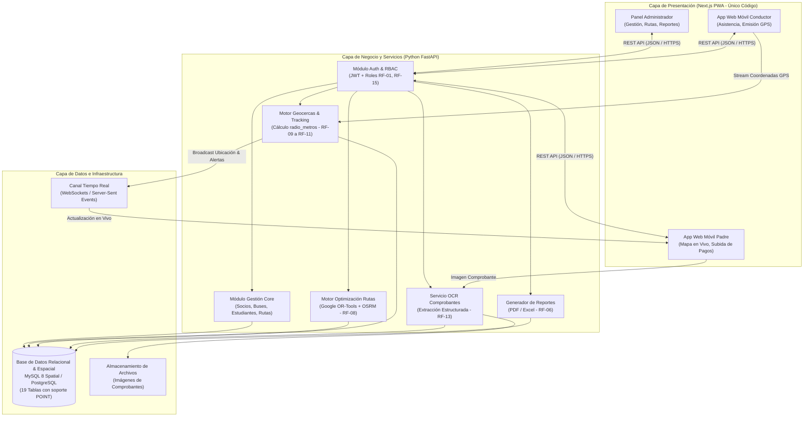

# Propuesta de Arquitectura y Stack Tecnológico — Sistema de Gestión y Monitoreo de Transporte Escolar

Este documento presenta la recomendación tecnológica óptima para el desarrollo del sistema, alineada con los **15 Requerimientos Funcionales (`requerimientos.md`)**, las **19 entidades del modelo de base de datos (`model.pdf`)** y la restricción crítica de tiempo (**entregar el 50% funcional hasta el martes**), manteniendo argumentos sólidos de **escalabilidad, mantenibilidad y rigor académico** para defensa de tesis.

---

## 1. Diagnóstico Técnico de tu Proyecto

Al cruzar tus requerimientos con tu diagrama entidad-relación (`model.pdf`), el sistema tiene **5 pilares técnicos clave** que condicionan la elección de tecnologías:

1. **Gestión Administrativa Multi-Rol y Multi-Cooperativa (RF-01 a RF-06, RF-15):**
   - Tablas: `cooperativas`, `usuarios`, `roles`, `usuario_rol`, `socios`, `conductores`, `buses`, `instituciones_educativas`, `estudiantes`, `asignaciones_estudiante_ruta`.
   - Requiere control de acceso basado en roles (RBAC), aislamiento de datos (un padre solo ve a sus hijos; un conductor solo su ruta) y generación rápida de CRUDs y reportes.
2. **Datos Geoespaciales Nativos (`POINT`) y Geocercas (RF-09, RF-10, RF-11):**
   - Tablas: `posiciones_gps` (`geom POINT`), `paradas` (`geom POINT`, `radio_metros`), `estudiantes` (`domicilio_geom POINT`), `instituciones_educativas` (`geom POINT`).
   - Requiere cálculo de distancias en tiempo real para disparar notificaciones cuando el bus entra al `radio_metros` de una parada.
3. **Optimización Matemática de Rutas — VRP/TSP (RF-08):**
   - Tablas: `rutas`, `paradas` (`orden`, `eta_estimado`), `ausencias_estudiante`, `eta_historico`.
   - Tu requerimiento RF-08 menciona explícitamente **Google OR-Tools**, cuya implementación más madura, directa y documentada está en **Python**.
4. **Procesamiento de Comprobantes con OCR (RF-12, RF-13, RF-14):**
   - Tablas: `pagos`, `tarifas_estudiante`, `comprobantes` (`monto_extraido`, `fecha_transferencia`, `referencia_extraida`, `ocr_confianza`, `banco`).
   - Requiere procesamiento de imágenes en el backend mediante motores OCR o Vision LLMs.
5. **Monitoreo GPS en Tiempo Real y Notificaciones Push (RF-07, RF-09, RF-10, RF-11):**
   - Tablas: `viajes`, `posiciones_gps`, `novedades_viaje`, `notificaciones`.
   - Requiere WebSockets o canales de suscripción en tiempo real para que el mapa de los padres se actualice sin recargar la página.

---

## 2. Stack Tecnológico Recomendado (Óptimo, Escalable y Rápido de Desarrollar)

Para llegar al **50% este martes** sin sacrificar calidad arquitectónica, la clave es **no desarrollar tres aplicaciones separadas desde cero** (Web Admin + App Android Conductor + App Android Padre), sino usar una **Arquitectura Web Responsiva + PWA (Progressive Web App)** con un **Backend en Python (FastAPI)** y **Supabase / PostgreSQL (o MySQL 8)**.

| Capa | Tecnología Recomendada | Alternativa Viable | Rol en el Sistema |
| :--- | :--- | :--- | :--- |
| **Frontend (Web + Móvil PWA)** | **Next.js (React) + Tailwind CSS + shadcn/ui** | Flutter (Web + Android) | Panel Admin Web y App Móvil instalable (PWA) para Conductores y Padres desde un **único código fuente**. |
| **Backend / API REST & WS** | **Python + FastAPI + SQLAlchemy (o SQLModel)** | NestJS (Node.js) | Lógica de negocio, endpoint de optimización con **Google OR-Tools**, procesamiento **OCR** y WebSockets. |
| **Base de Datos & Realtime** | **PostgreSQL + PostGIS (vía Supabase)** *(o MySQL 8 Spatial)* | MySQL 8.0 local/Cloud | Almacenamiento relacional de las 19 tablas, tipos espaciales `POINT`, almacenamiento de imágenes (`comprobantes`) y canales Realtime. |
| **Mapas y Geolocalización** | **Leaflet (`react-leaflet`) + OpenStreetMap + OSRM** | Google Maps JS API | Visualización de rutas, marcadores de paradas, tracking GPS en vivo sin requerir tarjeta de crédito o altos costos de API. |
| **Optimización de Rutas (RF-08)** | **Google OR-Tools (Python) + OSRM Table API** | Google Routes API | Cálculo de matriz de distancias y resolución del TSP/VRP considerando solo estudiantes activos (sin ausencia registrada). |
| **Motor OCR (RF-13)** | **Gemini 2.5 Flash API (Vision) / EasyOCR / Tesseract** | AWS Textract | Extracción estructurada en JSON (`banco`, `monto_extraido`, `fecha_transferencia`, `referencia_extraida`, `ocr_confianza`). |
| **Reportes (RF-06)** | **SheetJS (`xlsx`) + `jspdf` / `WeasyPrint`** | ReportLab | Exportación de reportes de rutas, estudiantes y pagos en Excel y PDF. |

---

## 3. Justificación Detallada por Tecnología (Para tu Documento de Tesis)

### 3.1. Backend: Python + FastAPI
* **Por qué es óptimo para tu tesis:**
  1. **Integración nativa con Google OR-Tools (RF-08):** Google OR-Tools tiene soporte de primera clase en Python. Calcular la ruta óptima leyendo las coordenadas de `paradas` y filtrando `ausencias_estudiante` toma menos de 60 líneas de código en Python.
  2. **Ecosistema nativo de IA y OCR (RF-13):** Tanto si usas `EasyOCR`/`Pytesseract` como un modelo multimodal estructurado (Gemini Flash API / OpenAI Vision) para poblar la tabla `comprobantes` (`monto_extraido`, `ocr_confianza`, `referencia_extraida`), Python es el estándar de la industria.
  3. **Alto Rendimiento (Asincronía):** FastAPI está construido sobre `Starlette` y `Pydantic`, ofreciendo un rendimiento comparable a NodeJS y Go gracias a su soporte `async/await`, ideal para recibir ráfagas de coordenadas en `posiciones_gps` (RF-09).
  4. **Documentación Automática (Swagger / OpenAPI):** Genera automáticamente la interfaz `/docs` para probar todos tus endpoints sin perder tiempo armando colecciones manuales, acelerando el desarrollo para el martes.

### 3.2. Frontend Unificado: Next.js (React) como PWA + Tailwind CSS + shadcn/ui
* **Por qué es la decisión más inteligente para llegar al martes:**
  1. **Un solo proyecto para los 3 roles (RF-01, RF-15):** En lugar de programar un sistema web para el Administrador y una app móvil aparte en Kotlin/Flutter para Padres y Conductores, una **PWA (Progressive Web App)** en Next.js se adapta a escritorio para el Administrador (tablas, reportes, gestión de socios/rutas) y se instala como aplicación móvil con acceso al **GPS del navegador (`navigator.geolocation.watchPosition`)** para el Conductor y vista móvil para el Padre.
  2. **Velocidad de UI con `shadcn/ui`:** Te da tablas con filtros, modales, formularios validados (`react-hook-form` + `zod`) y menús laterales dinámicos por rol en cuestión de minutos.
  3. **Mantenibilidad y Escalabilidad:** Arquitectura modular basada en componentes tipados con **TypeScript**, evitando errores en tiempo de ejecución.

### 3.3. Base de Datos: Compatibilidad con tu `model.pdf` (MySQL 8 vs. PostgreSQL/Supabase)
Tu diagrama en `model.pdf` fue diseñado en **MySQL Workbench** (usa `TINYINT`, `DATETIME(6)`, `ENUM`, `POINT`). Tienes dos caminos excelentes:
* **Opción A — Respetar 100% el motor del diagrama: MySQL 8.0+ con Spatial Extensions**
  - Tu script SQL exportado desde MySQL Workbench correrá **sin cambiar una sola línea**.
  - MySQL 8 incluye soporte nativo para `POINT` y funciones espaciales como `ST_Distance_Sphere(parada.geom, bus.geom)` para saber exactamente a cuántos metros está el bus de la parada (`radio_metros` en RF-11).
* **Opción B — Usar Supabase (PostgreSQL + PostGIS + Storage + Realtime)**
  - Si migras el DDL a PostgreSQL/Supabase (proceso que toma 5 minutos), obtienes **gratis y listo para usar**:
    1. **Supabase Storage:** Para guardar las fotos de los comprobantes de pago (`comprobantes.archivo_url`, RF-12) sin configurar servidores de archivos.
    2. **Supabase Realtime:** Cuando se inserta un registro en `posiciones_gps` o `notificaciones`, el frontend de los padres recibe el evento en vivo en milisegundos sin que tengas que programar servidores WebSocket complejos (RF-09, RF-10, RF-11).

### 3.4. Mapas y Ruteo: Leaflet + OpenStreetMap + OSRM + Google OR-Tools
* **Por qué elegir este combo:**
  - **Cero bloqueos de facturación:** `React-Leaflet` + OpenStreetMap es 100% gratuito.
  - **Cálculo de rutas reales por calles:** Combinas **Google OR-Tools** (que decide el *orden óptimo* de las paradas `1 -> 2 -> 3` según RF-08) con **OSRM (Open Source Routing Machine)** para dibujar la polilínea exacta sobre las calles y estimar el ETA (`eta_estimado`).

### 3.5. OCR Inteligente para Comprobantes (RF-12 y RF-13)
* **Cómo resolver RF-13 en 1 hora de programación:**
  - Tu tabla `comprobantes` pide extraer: `banco`, `monto_extraido`, `fecha_transferencia`, `referencia_extraida` y `ocr_confianza`.
  - Con OCR tradicional (Tesseract), cada banco (Pichincha, Guayaquil, Pacífico, Produbanco) tiene un diseño distinto y las expresiones regulares fallan constantemente.
  - **Solución óptima:** Usar un pipeline híbrido en Python con **Gemini 2.5 Flash API (Structured Outputs)** o **EasyOCR + parser**. Le pasas la imagen del comprobante y un esquema Pydantic, y te devuelve en 1.5 segundos el JSON exacto con `banco`, `monto_extraido`, `fecha_transferencia`, `referencia_extraida` y el porcentaje de confianza `ocr_confianza` listo para insertar en la tabla `comprobantes`.

---

## 4. Arquitectura del Sistema (Diagrama para tu Tesis)

---

## 5. Plan Estratégico para Entregar el 50% hasta el Martes

Tienes **15 Requerimientos Funcionales (RF-01 a RF-15)**. Por lo tanto, **el 50% equivale a 8 Requerimientos Funcionales completos y funcionando de punta a punta**, además del 100% de la base de datos creada.

El secreto para triunfar el martes es **completar todos los módulos base y administrativos + 1 módulo diferenciador ("efecto wow")**, dejando la integración fina de tiempo real u OCR secundario para el segundo 50%.

### ¿Qué incluir en el 50% del Martes? (8 de 15 RFs = 53.3%)

| Código | Requerimiento | Estado para el Martes | Por qué incluirlo en este primer 50% |
| :--- | :--- | :---: | :--- |
| **BD-00** | **Creación de las 19 tablas del `model.pdf` + Semilla de datos** | **100% Listo** | Demuestra que toda la arquitectura de datos ya está sólida. |
| **RF-01** | Inicio de sesión (Admin, Conductor, Padre) y menú según rol | **Incluido (1/8)** | Es la puerta de entrada obligatoria a toda la demostración. |
| **RF-15** | Restricción de acceso a datos según rol y vínculos | **Incluido (2/8)** | Se resuelve junto con RF-01 en el middleware de autenticación JWT. |
| **RF-02** | Gestión de socios de transporte y buses (CRUD sin duplicados) | **Incluido (3/8)** | CRUD directo que alimenta las rutas. Muy rápido de construir. |
| **RF-03** | Gestión de rutas, paradas y asignación de conductor/bus | **Incluido (4/8)** | Núcleo del sistema con selección de puntos en mapa Leaflet. |
| **RF-04** | Gestión de estudiantes, vínculo con representantes y asignación a ruta/parada | **Incluido (5/8)** | Permite poblar las rutas con estudiantes reales. |
| **RF-05** | Consulta de estudiantes por ruta (Filtro administrativo) | **Incluido (6/8)** | Toma 15 minutos una vez hecho el RF-04. |
| **RF-07** | Vista del Conductor: consultar estudiantes de su ruta y registrar asistencia del día | **Incluido (7/8)** | Demuestra el flujo en rol Conductor (`viajes` y asistencia). |
| **RF-08** | **Generación de ruta optimizada con Google OR-Tools** *(o RF-06 Reportes)* | **Incluido (8/8)** | Mostrar el mapa trazando la ruta optimizada con OR-Tools le da un **peso técnico enorme** a tu presentación del martes. |

*(Los 7 RFs restantes: RF-06 Reportes, RF-09/10/11 Tracking GPS en vivo y Geocercas, y RF-12/13/14 Pagos con OCR quedan programados para la segunda mitad, aunque puedes dejar la pantalla de pagos ya maquetada).*

---

### Cronograma de Ejecución (Sábado a Lunes)

* **Día 1 (Sábado) — Base de Datos, Backend Base y Autenticación (RF-01, RF-15):**
  1. Ejecutar el script SQL de tu `model.pdf` (19 tablas) e insertar datos semilla (`cooperativas`, 3 `roles`: Admin, Conductor, Padre).
  2. Levantar el proyecto **FastAPI** + modelos SQLAlchemy y autenticación JWT.
  3. Levantar el proyecto **Next.js + Tailwind** con el Login y el Layout dinámico que cambia el menú según el rol logueado.
* **Día 2 (Domingo) — Módulos de Gestión Core (RF-02, RF-03, RF-04, RF-05):**
  1. Pantallas y endpoints CRUD de **Socios, Conductores y Buses** (RF-02).
  2. Pantallas y endpoints de **Estudiantes y vinculación con Padres** (RF-04).
  3. Pantallas de **Rutas, Paradas (con mapa Leaflet para marcar `geom POINT`) y Asignación de Estudiantes** (RF-03, RF-05).
* **Día 3 (Lunes) — Flujo del Conductor y Optimización OR-Tools (RF-07, RF-08):**
  1. Endpoint en Python con `ortools` que recibe el `ruta_id`, toma las coordenadas de `paradas` activas, calcula el orden óptimo y actualiza `paradas.orden` y `eta_estimado` (RF-08).
  2. Vista móvil del **Conductor** para iniciar viaje (`viajes`), ver la lista ordenada de estudiantes, marcar recogida/ausencia (RF-07) y visualizar el mapa de la ruta.
  3. Pruebas integrales con datos de demostración reales para la presentación del martes.

