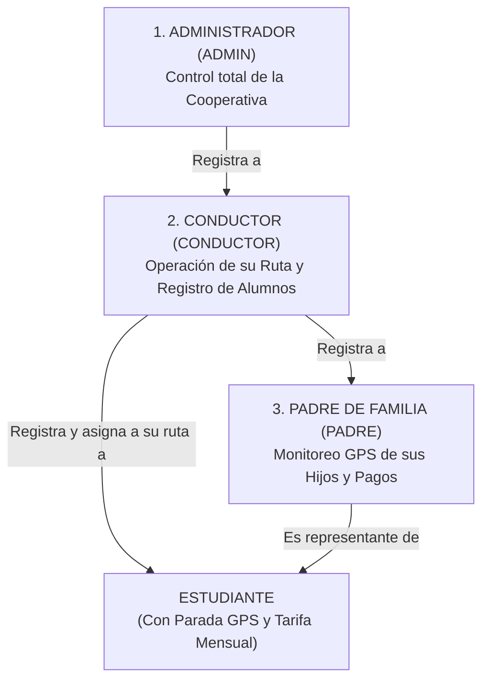

# Manual de Roles, Funciones y Permisos del Sistema (`RF-01` a `RF-15`)

Este documento detalla qué puede hacer (y qué tiene bloqueado) cada uno de los **3 roles principales** del Sistema de Transporte Escolar (`ADMIN`, `CONDUCTOR` y `PADRE`), cómo funciona el aislamiento de datos por Token JWT (`RF-01`, `RF-15`) y qué pantallas debe mostrar la App en **Flutter** a cada usuario.

---

## 1. Jerarquía General del Sistema

---

## 2. Rol 1: `ADMIN` (Administrador de la Cooperativa)

El **Administrador** gobierna toda la cooperativa, registra a los conductores/socios/buses, crea las rutas hacia las instituciones educativas, audita los pagos con OCR y descarga los reportes oficiales.

### ¿Qué puede hacer el `ADMIN`?
1. **Gestión de Flota y Personal (`RF-02`):**
   - Registrar, editar y activar/desactivar **Conductores** (`POST /api/flota/conductores`).
   - Registrar, editar y activar/desactivar **Socios propietarios** (`POST /api/flota/socios`).
   - Registrar, editar y activar/desactivar **Buses** validando placa única y capacidad máxima (`POST /api/flota/buses`).
2. **Gestión de Instituciones, Rutas y Paradas (`RF-03`, `RF-05`, `RF-08`):**
   - Registrar **Instituciones Educativas** con su coordenada geográfica (`POST /api/rutas/instituciones`).
   - Crear y editar **Rutas** asignando el Conductor responsable y el Bus (`POST /api/rutas`).
   - Crear, editar o eliminar **Paradas** de cualquier ruta (`POST /api/rutas/{id}/paradas`).
   - Ejecutar la **Optimización de Rutas con Google OR-Tools** (`POST /api/rutas/{id}/optimizar`).
3. **Supervisión de Padres y Estudiantes (`RF-04`, `RF-05`):**
   - Ver todos los padres y estudiantes de la cooperativa o filtrarlos por ruta (`GET /api/estudiantes`).
   - También puede registrar o editar padres, estudiantes, tarifas y asignaciones si se requiere apoyo administrativo.
4. **Control Financiero y Validación de Comprobantes OCR (`RF-12`, `RF-13`, `RF-14`):**
   - Generar las órdenes de cobro mensual para todos los estudiantes activos (`POST /api/pagos/generar-mes`).
   - Consultar todos los pagos del mes filtrando por estado (`PENDIENTE`, `EN_REVISION`, `PAGADO`, `RECHAZADO`) o por ruta (`GET /api/pagos`).
   - **Aprobar (`VALIDADO`) o Rechazar (`RECHAZADO`)** los comprobantes subidos por los padres (`PATCH /api/pagos/comprobantes/{id}/revisar`), lo cual pasa automáticamente el pago a `PAGADO` y envía una notificación al padre.
5. **Exportación de Reportes Oficiales (`RF-06`):**
   - Descargar reportes en **PDF** y **Excel (`.xlsx`)** de:
     - Rutas y unidades (`/api/reportes/rutas?formato=pdf|excel`)
     - Estudiantes por ruta (`/api/reportes/estudiantes?formato=pdf|excel`)
     - Estado de pagos y recaudación (`/api/reportes/pagos?formato=pdf|excel`)

### Menú que recibe el `ADMIN` al hacer Login (`data.menu`):
- `DASHBOARD_ADMIN` $\rightarrow$ `/admin/dashboard` *(Panel General)*
- `SOCIOS_BUSES` $\rightarrow$ `/admin/flota` *(Socios, Conductores y Buses)*
- `RUTAS_PARADAS` $\rightarrow$ `/admin/rutas` *(Rutas, Paradas y Optimización)*
- `ESTUDIANTES` $\rightarrow$ `/admin/estudiantes` *(Estudiantes y Representantes)*
- `PAGOS_COMPROBANTES` $\rightarrow$ `/pagos` *(Estado de Pagos y Comprobantes)*
- `REPORTES` $\rightarrow$ `/admin/reportes` *(Reportes y Exportación)*

---

## 3. Rol 2: `CONDUCTOR` (Conductor de Unidad Escolar)

El **Conductor** es registrado por el Administrador. En su aplicación móvil gestiona a los estudiantes de su recorrido, optimiza su ruta diaria, transmite su ubicación GPS y toma asistencia.

### ¿Qué puede hacer el `CONDUCTOR`?
1. **Registrar al Padre de Familia y al Estudiante en su Ruta (`RF-04`):**
   - **En 1 solo paso (`POST /api/estudiantes/registrar-padre-y-estudiante`):** Registra los datos del Padre + datos del Estudiante + coordenada GPS de su casa (`domicilio_geom`) + tarifa mensual. El sistema crea automáticamente la cuenta del Padre, crea al Estudiante, crea su **Parada GPS** y lo asigna a la ruta del Conductor.
   - **O por separado:** Puede registrar padres (`POST /api/estudiantes/padres`), registrar/editar estudiantes (`POST / PUT /api/estudiantes`), definir tarifas (`POST /api/estudiantes/{id}/tarifa`) y agregar paradas en su ruta (`POST /api/rutas/{id}/paradas`).
2. **Consultar su Ruta y sus Estudiantes (`RF-03`, `RF-05`, `RF-15`):**
   - Ver únicamente las rutas asignadas a su perfil de conductor (`GET /api/rutas`).
   - Ver la nómina de estudiantes asignados a su ruta (`GET /api/rutas/{id}/estudiantes` y `GET /api/estudiantes`).
3. **Optimizar su Recorrido con Google OR-Tools (`RF-08`):**
   - Ejecutar `POST /api/rutas/{id}/optimizar` antes o durante el viaje: el motor **Google OR-Tools** ordena las paradas de forma óptima, omite automáticamente a los estudiantes que notificaron ausencia ese día y le devuelve la polilínea para dibujar en su mapa Flutter.
4. **Operación Diaria del Viaje, Asistencia y Novedades (`RF-07`):**
   - Iniciar el viaje diario (`POST /api/viajes/iniciar`).
   - Consultar su hoja de ruta del día con el estado de cada niño (`GET /api/viajes/conductor/mi-ruta/estudiantes` o `/api/viajes/conductor/mi-ruta-hoy`).
   - Marcar asistencia cuando el estudiante sube al bus (`RECOGIDO` / `PRESENTE`) o no sale (`NO_ASISTIO` / `NO_SALIO`) (`POST /api/viajes/{id}/asistencia`).
   - Registrar novedades o incidentes del viaje, ej. tráfico, desvío o atraso (`POST /api/viajes/{id}/novedades`).
   - Finalizar el viaje al llegar al colegio o terminar el recorrido (`POST /api/viajes/{id}/finalizar`).
5. **Emitir Posición GPS en Tiempo Real y Disparar Geocercas (`RF-09`, `RF-11`):**
   - Enviar cada pocos segundos la ubicación GPS de su teléfono (`POST /api/gps/viajes/{id}/posicion`).
   - El Backend calcula automáticamente si el bus entró al radio de una parada (`radio_metros`) y envía sin intervención manual la **alerta de proximidad** al Padre de Familia correspondiente.
6. **Consultar Estado de Pagos de los Estudiantes de su Ruta (`RF-14`, `RF-15`):**
   - Ver quiénes de su ruta están `PAGADO`, `PENDIENTE` o `EN_REVISION` (`GET /api/pagos`).

### ¿Qué tiene BLOQUEADO el `CONDUCTOR` (`403 Forbidden`)?
- No puede registrar ni modificar a otros Conductores, Socios ni Buses (`/api/flota/...`).
- No puede ver rutas ni estudiantes de otros conductores (`RF-15`).
- No puede aprobar/validar comprobantes de pago (`PATCH /api/pagos/comprobantes/{id}/revisar`) ni generar cobros globales del mes.
- No puede descargar reportes globales de la cooperativa (`/api/reportes/...`).

### Menú que recibe el `CONDUCTOR` al hacer Login (`data.menu`):
- `CONDUCTOR_REGISTRO_PADRE_ESTUDIANTE` $\rightarrow$ `/conductor/registrar-estudiante` *(Registrar Padre y Estudiante)*
- `CONDUCTOR_RUTA` $\rightarrow$ `/conductor/mi-ruta` *(Mi Ruta y Asistencia del Día)*
- `CONDUCTOR_GPS` $\rightarrow$ `/conductor/recorrido-gps` *(Recorrido y Emisión GPS)*
- `PAGOS_COMPROBANTES` $\rightarrow$ `/pagos` *(Estado de Pagos de su Ruta)*

---

## 4. Rol 3: `PADRE` (Padre de Familia / Representante Legal)

El **Padre de Familia** es registrado por el Conductor cuando inscribe a su hijo en el recorrido. Solo tiene acceso estrictamente a la información de sus hijos representados (`RF-15`).

### ¿Qué puede hacer el `PADRE`?
1. **Consultar a sus Hijos y su Ruta Asignada (`RF-04`, `RF-15`):**
   - Ver únicamente la ficha, parada y tarifa de sus propios hijos (`GET /api/estudiantes` y `GET /api/rutas`).
2. **Monitorear el Bus en Tiempo Real (`RF-10`):**
   - Ver en el mapa la ubicación en vivo del bus de la ruta de su hijo, velocidad, próxima parada y tiempo estimado de llegada (ETA):
     - Por **WebSocket en vivo:** `ws://.../api/gps/ws/rutas/{ruta_id}?token=<JWT>`
     - Por **REST:** `GET /api/gps/rutas/{ruta_id}/ubicacion-actual`
3. **Recibir Notificaciones Automáticas de Geocerca y Pagos (`RF-11`):**
   - Consultar su bandeja de notificaciones cuando el bus está próximo a su casa o cuando su pago fue validado (`GET /api/gps/notificaciones`).
   - Marcar notificaciones como leídas (`PATCH /api/gps/notificaciones/{id}/leer`).
4. **Reportar Ausencia Previa de su Hijo (`RF-07`, `RF-08`):**
   - Avisar desde la App que su hijo no asistirá hoy (`POST /api/viajes/{viaje_id}/ausencias`), para que el conductor lo sepa y **Google OR-Tools** no pase por esa parada ese día.
5. **Subir Comprobantes de Pago en Imagen y Confirmar Datos OCR (`RF-12`, `RF-13`, `RF-14`):**
   - Consultar el estado de pago mensual de sus hijos (`GET /api/pagos`).
   - Subir la foto/captura de la transferencia bancaria (`POST /api/pagos/{pago_id}/comprobante`).
   - Ver los datos que el **Motor OCR** extrajo automáticamente (`banco`, `monto_extraido`, `fecha_transferencia`, `referencia_extraida`, `ocr_confianza`) y confirmarlos o corregirlos si la foto estaba borrosa (`PUT /api/pagos/comprobantes/{id}/confirmar-datos`).

### ¿Qué tiene BLOQUEADO el `PADRE` (`403 Forbidden`)?
- No puede registrar a ningún usuario ni estudiante (`POST /api/estudiantes/...` bloqueado).
- No puede ver datos, pagos ni ubicación de hijos de otros padres ni de otras rutas (`RF-15`).
- No puede emitir posiciones GPS del bus, ni iniciar/finalizar viajes, ni optimizar rutas con OR-Tools.
- No puede auto-aprobar sus propios comprobantes de pago.

### Menú que recibe el `PADRE` al hacer Login (`data.menu`):
- `PADRE_MONITOREO` $\rightarrow$ `/padre/monitoreo` *(Ubicación en Tiempo Real)*
- `PADRE_NOTIFICACIONES` $\rightarrow$ `/padre/notificaciones` *(Notificaciones de Proximidad)*
- `PAGOS_COMPROBANTES` $\rightarrow$ `/pagos` *(Estado de Pagos y Subida de Comprobantes OCR)*

---

## 5. Matriz Resumen de Permisos por Endpoint (`TokenRouteGuardMiddleware`)

| Módulo / Acción | Endpoint | `ADMIN` | `CONDUCTOR` | `PADRE` |
| :--- | :--- | :---: | :---: | :---: |
| **Iniciar Sesión y Obtener Menú** | `POST /api/auth/login` | ✅ | ✅ | ✅ |
| **Ver Perfil y Cambiar Contraseña** | `GET /api/auth/me`, `POST /api/auth/cambiar-password` | ✅ | ✅ | ✅ |
| **Registrar Conductores, Socios y Buses** | `POST / PUT / PATCH /api/flota/...` | ✅ | ❌ | ❌ |
| **Crear / Editar Rutas e Instituciones** | `POST / PUT / PATCH /api/rutas` | ✅ | ❌ | ❌ |
| **Registrar Padre + Estudiante (1 paso)** | `POST /api/estudiantes/registrar-padre-y-estudiante` | ✅ | ✅ | ❌ |
| **Registrar Padres / Estudiantes / Tarifas** | `POST / PUT /api/estudiantes/...` | ✅ | ✅ | ❌ |
| **Agregar / Editar Paradas en la Ruta** | `POST / PUT /api/rutas/{id}/paradas` | ✅ | ✅ | ❌ |
| **Ver Estudiantes y Rutas (`RF-15`)** | `GET /api/estudiantes`, `GET /api/rutas` | ✅ *(Todos)* | ✅ *(Su ruta)* | ✅ *(Sus hijos)* |
| **Optimizar Ruta con Google OR-Tools** | `POST /api/rutas/{id}/optimizar` | ✅ | ✅ | ❌ |
| **Iniciar Viaje, Asistencia y Novedades** | `POST /api/viajes/iniciar`, `/asistencia`, `/finalizar` | ✅ | ✅ | ❌ |
| **Reportar Ausencia de Estudiante** | `POST /api/viajes/{id}/ausencias` | ✅ | ✅ | ✅ |
| **Emitir Ubicación GPS del Bus** | `POST /api/gps/viajes/{id}/posicion` | ✅ | ✅ | ❌ |
| **Ver Ubicación del Bus en Vivo (REST/WS)** | `GET /api/gps/rutas/{id}/ubicacion-actual`, `WS` | ✅ | ✅ | ✅ |
| **Ver Notificaciones de Proximidad** | `GET / PATCH /api/gps/notificaciones` | ✅ | ✅ | ✅ |
| **Subir Comprobante con OCR y Confirmar** | `POST /api/pagos/{id}/comprobante`, `PUT .../confirmar-datos` | ✅ | ❌ | ✅ |
| **Consultar Estado de Pagos (`RF-14`)** | `GET /api/pagos` | ✅ *(Todos)* | ✅ *(Su ruta)* | ✅ *(Sus hijos)* |
| **Generar Mes y Aprobar Pagos OCR** | `POST /api/pagos/generar-mes`, `PATCH .../revisar` | ✅ | ❌ | ❌ |
| **Descargar Reportes PDF y Excel** | `GET /api/reportes/rutas\|estudiantes\|pagos` | ✅ | ❌ | ❌ |

