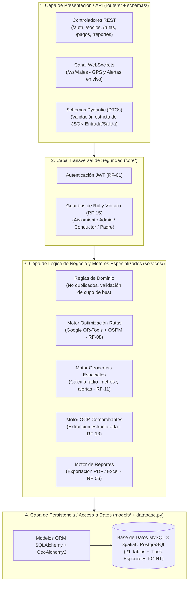

# Plan de Tareas y Arquitectura: Desarrollo del Backend al 100% (Python + FastAPI)

Este documento define la **Arquitectura del Backend** y detalla la hoja de ruta paso a paso (con lista de verificación) para construir el **100% del Backend** de tu sistema de transporte escolar, cubriendo las **21 tablas** de `model.pdf` y los **15 Requerimientos Funcionales (`RF-01` a `RF-15`)** de `requerimientos.md`.

---

## 1. Arquitectura Recomendada para el Backend: Monolito Modular en Capas (Modular Layered Architecture)

Para cumplir con la entrega del **50% el martes** y llegar al **100% con calidad de tesis**, la arquitectura ideal es una **Arquitectura en N-Capas Modulares (Modular Layered Architecture)** con separación de **Servicios de Dominio**, combinando el patrón **DTO (Data Transfer Object)** e **Inyección de Dependencias**.

### 1.1. Comparativa y Justificación Frente a Otras Arquitecturas

| Arquitectura | ¿Conviene para el Proyecto? | Justificación Técnica y Práctica |
| :--- | :---: | :--- |
| **Monolito Modular en Capas** *(Elegida)* | **Sí (10/10)** | Separa claramente las responsabilidades (Controladores HTTP/WS, Seguridad, Motores de Negocio y Acceso a Datos). Es **rápida de programar**, fácil de mantener y permite defender ante el jurado una separación limpia sin sobreingeniería. |
| **Hexagonal / Clean Architecture Pura** | Media (6/10) | Exige crear demasiados archivos por cada entidad (Ports, Adapters, UseCases, Domain Entities, Mappers). Con **21 tablas**, triplicaría el código repetitivo y retrasaría la entrega del martes. |
| **Microservicios Distribuídos** | **No (2/10)** | Desplegar 5 servidores separados (Auth, Flota, GPS, OCR, Optimizador) con brokers de mensajería (RabbitMQ/Kafka) consume demasiado tiempo en infraestructura sin aportar valor funcional a la tesis. |

### 1.2. Diagrama de las 4 Capas del Backend

Cada capa tiene una única responsabilidad y solo se comunica con la capa inmediata inferior:



### 1.3. Responsabilidad de Cada Capa (Para tu Documento de Tesis)

1. **Capa de Presentación / Controladores (`routers/` y `schemas/`):**
   - Recibe las peticiones HTTP o conexiones WebSocket, valida los datos de entrada/salida mediante **DTOs en Pydantic** y devuelve códigos de estado estándar (`200`, `201`, `400`, `403`, `404`). No contiene lógica matemática ni consultas complejas.
2. **Capa Transversal de Seguridad (`core/`):**
   - Mediante **Inyección de Dependencias** (`Depends` en FastAPI), valida el token JWT (`RF-01`) y aplica el control de acceso basado en roles y vínculos (`RF-15`: garantiza que un padre solo vea a sus hijos representados y un conductor únicamente su ruta asignada).
3. **Capa de Lógica de Negocio y Servicios (`services/`):**
   - Es el núcleo algorítmico del sistema, desacoplado de las rutas HTTP:
     - `optimizer.py`: Resuelve el problema de ruteo de vehículos (TSP/VRP) con **Google OR-Tools** (`RF-08`).
     - `geofence.py`: Calcula distancias esféricas hacia cada parada para disparar notificaciones cuando el bus entra en el `radio_metros` (`RF-11`).
     - `ocr_service.py`: Extrae banco, monto, fecha, referencia y nivel de confianza desde la imagen del comprobante (`RF-13`).
     - `report_service.py`: Genera los archivos descargables en PDF y Excel (`RF-06`).
   - **Escalabilidad futura:** Al estar aislados en `services/`, cualquiera de estos 4 motores puede extraerse a un microservicio independiente en el futuro sin reescribir los controladores.
4. **Capa de Persistencia / Datos (`models/` y `core/database.py`):**
   - Mapea las **21 tablas** de `model.pdf` mediante **SQLAlchemy ORM**, gestionando transacciones ACID (`commit`/`rollback`) y columnas geoespaciales `POINT`.

> **Texto listo para pegar en el capítulo de Arquitectura de tu Tesis:**
> *"Para el desarrollo del backend se implementó una **Arquitectura en N-Capas Modulares (Modular Layered Architecture)** combinada con el patrón **DTO (Data Transfer Object)** e **Inyección de Dependencias** sobre el framework asíncrono FastAPI. Esta arquitectura garantiza el principio de **Separación de Responsabilidades (SoC)**: desacopla los controladores REST/WebSocket de los servicios algorítmicos pesados (optimización combinatoria con Google OR-Tools, geocercas espaciales y reconocimiento óptico de caracteres OCR), permitiendo alta mantenibilidad en el desarrollo inicial y la capacidad de extraer cualquiera de los motores de servicio hacia microservicios independientes en caso de escalamiento horizontal."*

---

## 2. Estructura de Carpetas del Backend

Esta es la estructura física de archivos que refleja exactamente las 4 capas anteriores:

```text
backend/
├── app/
│   ├── main.py                  # Punto de entrada FastAPI + CORS + WebSockets
│   ├── core/                    # [CAPA 2: SEGURIDAD Y CONFIGURACIÓN TRANSVERSAL]
│   │   ├── config.py            # Variables de entorno (.env)
│   │   ├── database.py          # Conexión SQLAlchemy (MySQL 8 / PostgreSQL)
│   │   ├── security.py          # Hash de contraseñas (bcrypt) y creación/validación JWT
│   │   └── deps.py              # Dependencias de usuario actual y control de roles (RF-01, RF-15)
│   ├── models/                  # [CAPA 4: PERSISTENCIA - Las 21 tablas del model.pdf en SQLAlchemy]
│   ├── schemas/                 # [CAPA 1: DTOs - Validaciones de entrada/salida con Pydantic]
│   ├── routers/                 # [CAPA 1: PRESENTACIÓN - Endpoints REST y WS por módulo]
│   │   ├── auth.py              # RF-01, RF-15
│   │   ├── socios_buses.py      # RF-02
│   │   ├── rutas_paradas.py     # RF-03, RF-08
│   │   ├── estudiantes.py       # RF-04, RF-05
│   │   ├── viajes_asistencia.py # RF-07
│   │   ├── gps_tracking.py      # RF-09, RF-10, RF-11 (REST + WebSockets)
│   │   ├── pagos_ocr.py         # RF-12, RF-13, RF-14
│   │   └── reportes.py          # RF-06
│   └── services/                # [CAPA 3: LÓGICA DE NEGOCIO Y MOTORES ESPECIALIZADOS]
│       ├── optimizer.py         # Google OR-Tools + OSRM (RF-08)
│       ├── geofence.py          # Cálculo de distancia a paradas y alertas (RF-11)
│       ├── ocr_service.py       # Extracción de datos de comprobantes (RF-13)
│       └── report_service.py    # Generación de PDF y Excel (RF-06)
├── uploads/comprobantes/        # Almacenamiento local/cloud de imágenes de pago
├── requirements.txt
└── .env
```

---

## Fase 0: Creación del Entorno Virtual (`venv`) y Estructura de la Arquitectura
**Objetivo:** Antes de escribir cualquier lógica o modelo, aislar las dependencias de Python en un entorno virtual (`venv`) y construir el esqueleto completo de carpetas de las 4 capas para trabajar de forma ordenada.

- [x] **Tarea 0.1: Crear carpeta del proyecto y el Entorno Virtual (`venv`)**
  - Crear el directorio `backend/` en la raíz del proyecto.
  - Crear el entorno virtual de Python:
    ```powershell
    cd backend
    python -m venv venv
    .\venv\Scripts\Activate.ps1
    ```
- [x] **Tarea 0.2: Crear `requirements.txt` e instalar dependencias dentro del `venv`**
  - Generar el archivo `backend/requirements.txt` e instalar los paquetes en el entorno virtual activado (`pip install -r requirements.txt`):
    `fastapi`, `uvicorn[standard]`, `sqlalchemy`, `pymysql` (o `psycopg2-binary`), `geoalchemy2`, `shapely`, `pydantic[email]`, `pydantic-settings`, `python-jose[cryptography]`, `passlib[bcrypt]`, `python-multipart`, `ortools`, `httpx`, `openpyxl`, `reportlab`.
- [x] **Tarea 0.3: Construir la estructura física de la Arquitectura en Capas**
  - Crear todos los directorios y archivos `__init__.py` correspondientes a las 4 capas antes de empezar a programar:
    - `backend/app/core/` *(Capa 2: Seguridad y Configuración)*
    - `backend/app/models/` *(Capa 4: Persistencia ORM)*
    - `backend/app/schemas/` *(Capa 1: DTOs Pydantic)*
    - `backend/app/routers/` *(Capa 1: Controladores REST y WebSockets)*
    - `backend/app/services/` *(Capa 3: Lógica de Negocio y Motores OR-Tools / Geocercas / OCR / Reportes)*
    - `backend/uploads/comprobantes/` *(Almacenamiento de imágenes de pago)*
- [x] **Tarea 0.4: Crear `app/main.py` y `.env` base (Smoke Test de la Arquitectura)**
  - Configurar `app/main.py` con FastAPI, middleware CORS y un endpoint `/health` para verificar que el servidor (`uvicorn app.main:app --reload`) levante correctamente desde el `venv` antes de pasar a la base de datos.

---

## Fase 1: Configuración de Base de Datos y Modelos ORM (Las 21 Tablas)
**Objetivo:** Conectar la arquitectura ya creada a la base de datos con soporte geoespacial (`POINT`) y mapear las 21 tablas de `model.pdf`.

- [x] **Tarea 1.1: Script DDL y Conexión a Base de Datos (`core/config.py` y `core/database.py`)**
  - Configurar las variables de entorno en `.env` leídas por `core/config.py`.
  - Configurar `engine`, `SessionLocal` y `Base` en `core/database.py`.
  - Crear el script SQL / migración inicial respetando las 21 tablas exactas de `model.pdf`:
    1. `cooperativas`
    2. `usuarios`
    3. `roles`
    4. `usuario_rol`
    5. `socios`
    6. `conductores`
    7. `buses`
    8. `instituciones_educativas` *(con `geom POINT`)*
    9. `rutas`
    10. `paradas` *(con `geom POINT` y `radio_metros`)*
    11. `estudiantes` *(con `domicilio_geom POINT`)*
    12. `tarifas_estudiante`
    13. `asignaciones_estudiante_ruta`
    14. `viajes`
    15. `novedades_viaje` *(con `ubicacion POINT`)*
    16. `ausencias_estudiante`
    17. `posiciones_gps` *(con `geom POINT`)*
    18. `eta_historico`
    19. `pagos`
    20. `comprobantes`
    21. `notificaciones`
- [x] **Tarea 1.2: Modelos SQLAlchemy y Funciones Geoespaciales (`models/`)**
  - Mapear todas las tablas y relaciones (`ForeignKey`, `relationship`).
  - Crear helper para convertir coordenadas `(lat, lng)` a `POINT(lng lat)` y viceversa en JSON.
- [x] **Tarea 1.3: Seeder (Datos Semilla Iniciales)**
  - Crear un script `seed.py` que inserte automáticamente:
    - 1 Cooperativa por defecto (`cooperativas`).
    - Los 3 roles base en `roles`: `ADMIN`, `CONDUCTOR`, `PADRE`.
    - 1 usuario Administrador inicial en `usuarios` y `usuario_rol`.

---

## Fase 2: Autenticación, Seguridad y Control de Acceso por Rol (`RF-01`, `RF-15`)
**Objetivo:** Garantizar que cada usuario inicie sesión, reciba su menú correspondiente y solo pueda consultar los datos que le pertenecen.

- [x] **Tarea 2.1: Utilidades JWT y Hash de Contraseñas (`core/security.py`)**
  - Implementar `verify_password`, `get_password_hash` y `create_access_token` (incluyendo `usuario_id`, `cooperativa_id` y lista de `roles` en el payload del JWT).
- [x] **Tarea 2.2: Endpoints de Autenticación (`routers/auth.py` — `RF-01`)**
  - `POST /api/auth/login`: Valida credenciales (`email`/`cedula` y `password`), verifica `activo == 1`, consulta `usuario_rol` y devuelve el token JWT junto con el perfil y el árbol de menú permitido según su rol.
  - `GET /api/auth/me`: Devuelve los datos del usuario autenticado y sus roles activos.
- [x] **Tarea 2.3: Middlewares y Dependencias de Autorización (`core/deps.py` — `RF-15`)**
  - Crear dependencias inyectables en FastAPI:
    - `require_role(["ADMIN"])`: Solo administradores.
    - `require_role(["CONDUCTOR"])`: Extrae automáticamente el `conductor_id` asociado al `usuario_id`.
    - `require_role(["PADRE"])`: Filtra automáticamente las consultas por `estudiantes.representante_usuario_id == current_user.id`.

---

## Fase 3: Gestión Administrativa Core (`RF-02`, `RF-03`, `RF-04`, `RF-05`)
**Objetivo:** Completar todos los endpoints CRUD del Administrador con validaciones de duplicados y relaciones.

- [x] **Tarea 3.1: Módulo de Socios, Conductores y Buses (`routers/socios_buses.py` — `RF-02`)**
  - `POST /api/socios` y `GET /api/socios`: Crear y listar socios validando que no se duplique `cedula`/`email` en `usuarios` ni `usuario_id` en `socios`.
  - `PUT /api/socios/{id}` y `PATCH /api/socios/{id}/estado`: Actualizar datos y activar/desactivar (`activo = 0/1`).
  - `POST /api/conductores` y `GET /api/conductores`: Registrar conductores con validación de `licencia` única.
  - `POST /api/buses`, `GET /api/buses`, `PUT /api/buses/{id}`: Gestionar buses vinculados a un `socio_id` validando `placa` única y `capacidad`.
- [x] **Tarea 3.2: Módulo de Instituciones, Rutas y Paradas (`routers/rutas_paradas.py` — `RF-03`)**
  - `CRUD /api/instituciones`: Gestionar instituciones educativas guardando su ubicación `geom POINT`.
  - `POST /api/rutas`, `GET /api/rutas`, `PUT /api/rutas/{id}`: Crear rutas asignando `institucion_id`, `conductor_id`, `bus_id`, `turno ('AM', 'PM')` y `hora_campana`.
  - `POST /api/rutas/{ruta_id}/paradas` y `PUT /api/paradas/{id}`: Crear/editar paradas con `nombre`, `geom POINT(lng, lat)`, `radio_metros` (por defecto ej. 150m) y `orden`.
- [x] **Tarea 3.3: Módulo de Estudiantes, Representantes y Tarifas (`routers/estudiantes.py` — `RF-04`, `RF-05`)**
  - `POST /api/padres` y `GET /api/padres`: Crear usuarios con rol `PADRE` (representantes).
  - `POST /api/estudiantes`, `GET /api/estudiantes`, `PUT /api/estudiantes/{id}`: Registrar estudiante validando `cedula` única, vinculando `representante_usuario_id` y guardando `domicilio_geom POINT`.
  - `POST /api/estudiantes/{id}/tarifa`: Definir su tarifa mensual en `tarifas_estudiante`.
  - `POST /api/asignaciones-ruta`: Asignar un estudiante a una `ruta_id` y `parada_id` en `asignaciones_estudiante_ruta` (validando que no supere la `capacidad` del bus).
  - `GET /api/rutas/{ruta_id}/estudiantes` (`RF-05`): Consultar todos los estudiantes activos de una ruta específica con los datos de su representante y su parada.

---

## Fase 4: Operación Diaria del Conductor y Optimización OR-Tools (`RF-07`, `RF-08`)
**Objetivo:** Permitir la gestión de viajes diarios, ausencias, asistencia y el cálculo matemático de la ruta óptima.

- [x] **Tarea 4.1: Registro de Ausencias Previas y Gestión del Viaje (`routers/viajes_asistencia.py` — `RF-07`)**
  - `POST /api/viajes/iniciar`: El conductor inicia el recorrido del día (`viajes` con `fecha`, `estado = 'EN_CURSO'`, `inicio_at`).
  - `POST /api/viajes/{viaje_id}/ausencias`: Permite al padre o conductor registrar que un estudiante no asistirá hoy (`ausencias_estudiante`).
  - `GET /api/conductor/mi-ruta/estudiantes` (`RF-07`): Lista a los estudiantes de la ruta asignada al conductor autenticado e indica quiénes tienen ausencia reportada hoy.
  - `POST /api/viajes/{viaje_id}/asistencia` (`RF-07`): Registra el estado de recogida/asistencia de cada estudiante en el viaje y permite reportar incidentes en `novedades_viaje`.
  - `POST /api/viajes/{viaje_id}/finalizar`: Marca `fin_at` y cambia el estado del viaje a `'FINALIZADO'`.
- [x] **Tarea 4.2: Motor de Optimización de Rutas con Google OR-Tools (`services/optimizer.py` — `RF-08`)**
  - `POST /api/rutas/{ruta_id}/optimizar`:
    1. Consulta todas las `paradas` de la ruta que tengan al menos un estudiante activo asignado **sin ausencia registrada para hoy**.
    2. Obtiene la matriz de tiempos/distancias entre las coordenadas `geom` de las paradas y la `institucion_educativa` (usando OSRM Table API o distancia Haversine ponderada).
    3. Ejecuta `ortools.constraint_solver.pywrapcp` (TSP/VRP) fijando la institución educativa como destino final (turno AM) o punto de partida (turno PM).
    4. Actualiza automáticamente el campo `paradas.orden` y `paradas.eta_estimado` en la base de datos y devuelve la polilínea óptima para dibujarla en el mapa.

---

## Fase 5: Monitoreo GPS en Tiempo Real y Geocercas Automáticas (`RF-09`, `RF-10`, `RF-11`)
**Objetivo:** Recibir la ubicación del conductor en vivo, transmitirla a los padres de esa ruta y enviar alertas automáticas de cercanía.

- [x] **Tarea 5.1: Ingesta GPS y Canal WebSocket por Ruta (`routers/gps_tracking.py` — `RF-09`, `RF-10`)**
  - `POST /api/viajes/{viaje_id}/gps` (o vía WebSocket `WS /ws/viajes/{viaje_id}`):
    - Recibe del conductor `{ lat, lng, velocidad_kmh, heading }`.
    - Inserta el punto en `posiciones_gps` (`geom POINT`).
    - Retransmite en tiempo real el paquete JSON a todos los padres suscritos al canal de esa `ruta_id` (`RF-10`).
  - `GET /api/rutas/{ruta_id}/ubicacion-actual` (`RF-10`): Devuelve la última coordenada registrada del viaje activo para carga inicial del mapa del padre.
- [x] **Tarea 5.2: Motor de Geocercas y Notificaciones de Proximidad (`services/geofence.py` — `RF-11`)**
  - Cada vez que ingresa una coordenada a `posiciones_gps`:
    1. Calcula la distancia en metros hacia las siguientes `paradas` de la ruta (con `ST_Distance_Sphere` en SQL o fórmula Haversine en Python).
    2. Si `distancia <= parada.radio_metros` y aún no se ha enviado alerta para esa parada en el `viaje_id` actual:
       - Busca a los representantes (`representante_usuario_id`) de los estudiantes asignados a esa parada.
       - Crea el registro en la tabla `notificaciones` (`tipo = 'PROXIMIDAD'`, `titulo = 'Transporte cerca'`, `mensaje = 'La unidad está a menos de X metros de su parada'`).
       - Envía el evento en vivo por WebSocket al padre y registra la métrica en `eta_historico`.
- [x] **Tarea 5.3: Endpoints de Notificaciones para Padres**
  - `GET /api/notificaciones`: Lista las notificaciones del usuario autenticado.
  - `PATCH /api/notificaciones/{id}/leer`: Marca `leida = 1`.

---

## Fase 6: Pagos, Subida de Comprobantes y Motor OCR (`RF-12`, `RF-13`, `RF-14`)
**Objetivo:** Gestionar las mensualidades de los estudiantes, recibir imágenes de transferencias/depósitos y extraer sus datos automáticamente con OCR.

- [x] **Tarea 6.1: Generación y Consulta de Estado de Pagos (`routers/pagos_ocr.py` — `RF-14`)**
  - `POST /api/pagos/generar-mes`: Genera los registros en `pagos` (`mes`, `anio`, `monto` tomado de `tarifas_estudiante`, `estado = 'PENDIENTE'`) para los estudiantes activos.
  - `GET /api/pagos`:
    - Si es **Padre**: devuelve los pagos de sus representados (`PENDIENTE`, `EN_REVISION`, `PAGADO`).
    - Si es **Conductor**: devuelve el estado de pagos de los estudiantes de su ruta (`RF-14`).
    - Si es **Admin**: devuelve todos los pagos con filtros por ruta, mes y estado.
- [x] **Tarea 6.2: Subida de Imagen y Procesamiento OCR (`services/ocr_service.py` — `RF-12`, `RF-13`)**
  - `POST /api/pagos/{pago_id}/comprobante`:
    1. Recibe el archivo de imagen (`UploadFile`) enviado por el padre y lo guarda en `uploads/comprobantes/`, registrando `archivo_url` (`RF-12`).
    2. Pasa la imagen por el servicio OCR (`EasyOCR` / `Tesseract` o `Gemini Vision API` con respuesta JSON estructurada) para extraer automáticamente:
       - `banco`
       - `monto_extraido`
       - `fecha_transferencia`
       - `referencia_extraida` (número de comprobante/documento)
       - `ocr_confianza` (porcentaje 0 a 100)
    3. Guarda el registro en la tabla `comprobantes` con `estado = 'PENDIENTE_REVISION'` y cambia el estado de `pagos` a `'EN_REVISION'` (`RF-13`).
    4. Devuelve al frontend los datos extraídos por el OCR para que el padre o el administrador los confirme o corrija.
- [x] **Tarea 6.3: Aprobación / Rechazo de Comprobantes (`RF-13`, `RF-14`)**
  - `PATCH /api/comprobantes/{id}/revisar`: Permite confirmar o rechazar el comprobante; si se aprueba, actualiza automáticamente `pagos.estado = 'PAGADO'` y envía una notificación al padre.

---

## Fase 7: Generación y Exportación de Reportes (`RF-06`)
**Objetivo:** Permitir al administrador exportar reportes filtrados en formatos **Excel (`.xlsx`)** y **PDF (`.pdf`)**.

- [x] **Tarea 7.1: Servicio de Exportación (`routers/reportes.py` & `services/report_service.py` — `RF-06`)**
  - `GET /api/reportes/rutas?formato=pdf|excel`: Exporta el listado de rutas con su bus, placa, socio, conductor asignado y total de estudiantes.
  - `GET /api/reportes/estudiantes?ruta_id={id}&formato=pdf|excel`: Exporta el padrón de estudiantes por ruta con datos de su representante, teléfono y parada asignada.
  - `GET /api/reportes/pagos?mes={m}&anio={a}&estado={e}&formato=pdf|excel`: Exporta el reporte financiero de pagos recaudados, pendientes y en revisión con referencias de comprobantes.

---

## Resumen de Prioridad para tu Entrega del Martes vs. 100%

1. **Bloque 1 (Para el 50% del Martes):** Fases **0, 1, 2, 3 y 4** completas (`RF-01`, `RF-02`, `RF-03`, `RF-04`, `RF-05`, `RF-07`, `RF-08`, `RF-15`).
2. **Bloque 2 (Para completar el 100% del Backend):** Fases **5, 6 y 7** (`RF-06`, `RF-09`, `RF-10`, `RF-11`, `RF-12`, `RF-13`, `RF-14`).

